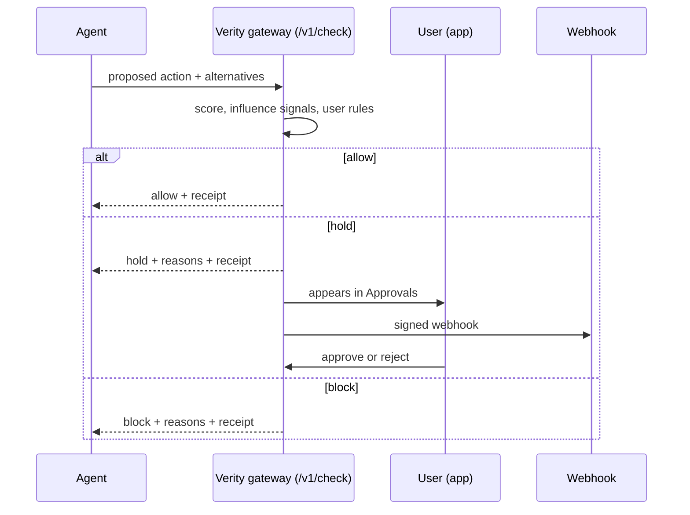

# Architecture

## Idea

Verity sits between an agent and the outside world. The agent proposes an action; Verity decides before anything happens.

## Decision pipeline (`core.js`)

Layers wrap each other, innermost first:

1. `score` normalises price, rating and delivery speed and weights them by the user's priorities. Fit is the picked option's score divided by the best option's score.
2. `analyse` adds influence signals: paid placement, defaults, hidden options, margin gaps, inflated list price, pressure tactics, low review counts, surge, add-ons, price history, return and late rates. Deceptive patterns lower fit by 8 points each.
3. `decide` applies the user's rules: pause, blocks, category modes, budgets, caps, quiet hours, custom rules, burst guard, cooling-off, trusted-only, floors, duplicate guard, away mode, then autopilot. It returns `done`, `pending` or `blocked`, with reasons.

The same file runs in the browser (to explain decisions) and in Node (to enforce them).

## Components

| Part | Role |
|---|---|
| `server.js` | Static files, state, Server-Sent Events to the app, webhooks, simulation |
| `integration.js` | `/v1` API, listing adapter, scoped keys, rate limit, idempotency, receipt chain |
| `datalab.js` | Pure parsing and analytics, no network, used by the app and tests |
| App files | Base app plus feature layers, each registering tabs into the Explore screen |

## Trust boundaries

Agents are untrusted: they get decisions, never state. The app reads state over Server-Sent Events. Webhook receivers verify the HMAC signature. Receipts are signed with a server secret and chained, so the audit log is tamper-evident to anyone who can verify.

## Where it would change for production

| Prototype | Production |
|---|---|
| JSON file | Relational database, one row per decision and receipt |
| In-memory rate limit and idempotency | Shared cache |
| Server-Sent Events from one process | Pub/sub with several servers |
| Placeholder listing fields | Adapter over the marketplace's real catalog and order events |
| Demo secret | Managed secret with rotation |
| Open `/api` routes | Authenticated user and admin APIs |

## Known trade-off

The backtest on imported history cannot score influence because exports hold only the chosen item. Influence scoring needs the alternatives the agent saw, which only a live integration can provide.
